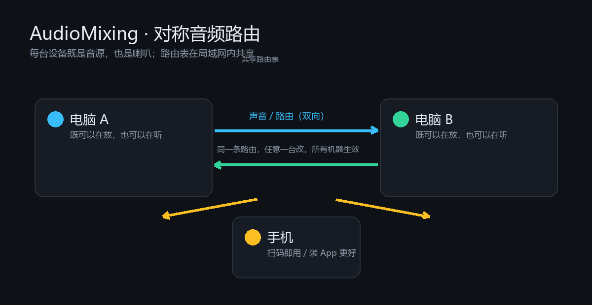

# AudioMixing

[中文](README.md) | [English](README.en.md)

> Two people, two headsets, one game or one movie — together.


LAN only. No server, no account.

[⬇️ Download for Windows](https://github.com/haop2922-ai/AudioMixing/releases) · [⬇️ Download for Android](https://github.com/haop2922-ai/AudioMixing/releases)

✅ 584 unit tests · the build runs them first and refuses to produce an exe if any fail

## How it differs from other audio forwarding tools

Most tools in this space work like a radio station: one computer broadcasts, every
other device is a receiver. That is a one-way star. AudioMixing is **symmetric**:



- Every computer can be both a source and a speaker;
- The routing table is shared across the LAN — change it on any machine and every
  machine picks it up;
- Each route has its own mute and volume;
- Audio coming in over Bluetooth from a phone can be used as a source and forwarded
  to another room;
- One computer can play to several headsets at once (useful for local co-op);
- Broadcast and listen-only are mutually exclusive — either you talk or you listen,
  so a loop cannot form by construction;
- Phones can act as speakers in two ways: a web page (scan a QR code, install
  nothing) or the native app (lower latency).

## Who this is NOT for

- You only need "PC audio to my phone" — a dedicated tool for that is less effort;
- You need to cross networks or use a relay — this project is LAN-only on purpose;
- You need macOS, Linux or iOS — Windows + Android only;
- You need lossless, guaranteed-glitch-free professional audio — ordinary Wi-Fi
  cannot promise that, and this is not an audio interface.

## Quick start

### Scenario 1: two computers

```text
1. Run AudioMixing on both machines (the exe or start.bat)
2. Right-click the tray icon → "Allow through firewall" (admin) → Yes
3. The console opens at http://127.0.0.1:17800
4. On the machine that wants to listen, add a route: [the other PC] → [this PC]
```

### Scenario 2: phone as a speaker

```text
1. Turn on "Broadcast my sound" on the PC
2. Scan the QR code on the console → open the listener page → tap Start
   or: install the APK → tap "🔊 Speaker"
3. Web listeners can pick one of three quality tiers: Saver / Balanced / Quality
```

### Scenario 3: one PC, two headsets

```text
Console → "Multi-headphone" → tap cards in Simple view, or cells in the matrix
(The system default device plays directly and is never duplicated)
```

Full instructions: [docs/使用说明.md](docs/使用说明.md). Known limits:
[docs/已知限制与边界.md](docs/已知限制与边界.md) (Chinese).

## Firewall and ports

Allow these on first run (LAN only, not exposed to the internet):

| Port | Protocol | Purpose |
|---|---|---|
| 17830 | UDP | LAN device discovery (must match on both ends) |
| 47831 | UDP | Point-to-point audio |
| 47832 | UDP | Broadcast audio |

> To open the console or the listener page from a phone or another PC, also allow
> **TCP 17800** (the panel port). The tray item "Allow through firewall" creates all
> of these rules at once.

### Windows steps

1. Windows Security → Firewall & network protection → Advanced settings;
2. Inbound Rules → New Rule → Port → UDP;
3. Specific local ports: `17830, 47831, 47832` → Allow the connection;
4. Tick "Private networks" only → name it `AudioMixing`;
5. Repeat for TCP `17800` if phones should open the panel.

### Troubleshooting

If devices cannot find each other, check in this order:

1. Both devices are on the **same subnet** (e.g. both `192.168.1.x`);
2. The router does not have **AP isolation / guest network** enabled;
3. The three UDP ports above are allowed;
4. Still nothing? Enter the PC's IP manually under "Settings → Discovery" on the phone.

## Design trade-offs

- **Point-to-point and broadcast are two separate mechanisms.** Routes are
  bidirectional and need no cooperation from the peer; broadcast is one-way and only
  plays on devices that enabled listen-only.
- **One writer per sound card.** Multiple routes to the same output device are mixed
  and written once; two independent renderers would step on each other and destroy
  audio quality.
- **Broadcast and listen-only are mutually exclusive.** Listen-only stops only the
  broadcast sender; normal routes keep working.
- **Bitrate tiers on the phone side.** Web listeners choose between three tiers:

  | Tier | Sample rate / channels | Approx. bitrate | Good for |
  |---|---|---|---|
  | Saver | 24 kHz mono | 47 KB/s | Game footsteps, weak Wi-Fi, long sessions |
  | Balanced (default) | 48 kHz mono | 94 KB/s | Video, meetings, everyday use |
  | Quality | 48 kHz stereo | 188 KB/s | Music, strong Wi-Fi |

  > The native Android listener uses point-to-point RTP at 48 kHz stereo and is not
  > affected by these tiers. If the web listener stutters, switch to Saver first,
  > then check router signal and interference.

## Monitoring and diagnostics

- The monitor page shows channel, source, target, bytes, latency, buffer, packet
  loss, clock drift, and the web listener's current tier and real bitrate;
- The "Diagnostics" page downloads a zip bundle with logs, config, device list and
  network self-checks;
- Every fix is documented (location / cause / change / regression test) in
  [docs/BUG修复明细.md](docs/BUG修复明细.md) (Chinese).

## Building it yourself

```bash
# Windows + Python 3.11+
python -m pip install nuitka numpy pyogg opuslib_next qrcode pillow
python tools/build_nuitka.py          # output: dist_nuitka\AudioMixing.exe (~22 MB, one file)
```

**Why Nuitka instead of PyInstaller:** PyInstaller's one-file mode extracts itself
into a temp directory at startup. Some security tools (Huorong HIPS, game overlays)
block that and the app dies with `Could not create temporary directory!`. Switching
packagers avoids the interception entirely.

⚠️ Use the **python.org** build of Python. The Microsoft Store build lacks linkable
library files and Nuitka cannot compile against it.

⚠️ Do not run the delivered exe from a directory that is rebuilt constantly — some
security tools block that path. See [docs/构建与分发.md](docs/构建与分发.md) and
[docs/排查实录-改名事故.md](docs/排查实录-改名事故.md) (Chinese).

Code layout:

```text
audiomixing/
  engine.py          core: devices, routes, sinks, passthrough, multi-output
  net/rtpaudio.py    RTP send/receive, jitter buffer, clock alignment
  net/discovery.py   LAN discovery (UDP 17830; audio ports come from the beacon)
  audio/             WASAPI capture/render, Opus, capture sharing, multi-output
  webui.py           console, monitor, diagnostics over HTTP
  ui/                front-end pages
  bluetooth.py       the Bluetooth (A2DP sink) input path
audiomixing_launcher.py  launcher (tray, monitor window, single instance)
tools/               build, self-check and maintenance tools
```

## Tests and build gates

```bash
# Full unit test suite
python -m unittest discover -s tests

# Build gate: syntax check / full tests / page script check; aborts without an exe
python tools/build_nuitka.py --test
```

The current main branch has **584 unit tests**. There are also a two-node self-test
(44 checks), exe acceptance (13 checks), APK delivery checks (version / symbols /
six identical copies) and static UI gates.

## License

Apache License 2.0 — see [LICENSE](LICENSE).

Commercial use, modification, distribution and private use are permitted; keep the
copyright notice and the LICENSE file. The license history is documented in
[docs/许可变更公告.md](docs/许可变更公告.md) (Chinese).

## About AI involvement

The author independently defined the requirements, designed the architecture and did
all of the validation. AI was used to assist with coding.

The author is responsible for:

- All product positioning and feature trade-offs (symmetric routing, shared routing
  table, multi-headset output, browser speaker);
- All architecture decisions (module boundaries, RTP transport, discovery design);
- All key trade-offs (single-writer mixing per sound card, broadcast/listen-only
  mutual exclusion to prevent loops, choosing Nuitka over PyInstaller to avoid
  security-tool interception);
- All validation (unit tests, pre-build gates, real-device regression);
- All debugging and root-cause analysis (see [docs/BUG修复明细.md](docs/BUG修复明细.md)).

AI assisted with: parts of the boilerplate code and some documentation wording.
Every AI-generated change was read, modified and tested by the author before merging.

## Author: haop2922 (HWHHYN)
