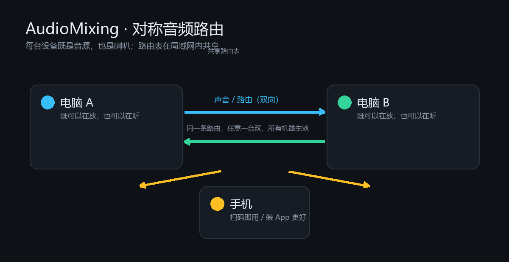

# AudioMixing

[中文](README.md) | [English](README.en.md)

> 让两个人各戴各的耳机，一起打游戏 / 看电影。


只走局域网，不经服务器，不需要账号。

[⬇️ 下载 Windows 版](https://github.com/haop2922-ai/AudioMixing/releases) · [⬇️ 下载 Android 版](https://github.com/haop2922-ai/AudioMixing/releases)

✅ 584 项单元测试 · 构建前自动跑测试，不通过不产出 exe

## 它和别的音频转发软件有什么不同

常见的音频转发软件（例如 AudioRelay）是**一台电脑当电台，其他设备当收音机**，
单向星形结构。AudioMixing 的结构是**对称的**：



- 每一台电脑都既可以是声音的来源，也可以是声音的喇叭；
- 路由表在整个局域网里共享 —— 在任意一台机器上改，所有机器都生效；
- 每条路由可以单独静音、单独调音量；
- 手机蓝牙进来的声音可以当一路音源，转发到别的房间；
- 一台电脑可以同时把声音送到多个耳机 / 音箱（双人游戏用）；
- 广播与「只听」互斥 —— 要么说，要么听，结构上不会形成回环；
- 手机当喇叭有两个版本：网页版（扫码即用，不装东西）和 App 版（原生播放，延迟更低）。

## 不适合谁

- 只想要「电脑声音给手机听」这一件事 —— 那种场景专门的软件更省事；
- 需要跨网络 / 中继 —— 本项目刻意只做局域网；
- 需要 macOS / Linux / iOS —— 目前只有 Windows + Android；
- 需要「无损、绝对不卡」的专业音频传输 —— 普通 Wi-Fi 做不到，本项目也不做音频接口。

## 快速开始

### 场景一：两台电脑互传

```text
1. 两台电脑都运行 AudioMixing（exe 或 start.bat）
2. 右键托盘图标 → 放行防火墙（需管理员）→ 点「是」
3. 浏览器自动打开控制台 http://127.0.0.1:17800
4. 在要听的那台上建一条路由：从 [对方电脑] 到 [本机]
```

### 场景二：手机当喇叭

```text
1. 电脑上打开「广播我的声音」
2. 手机相机扫控制台上的二维码 → 打开听众页 → 点开始
   或者：手机装 APK → 点「🔊 当喇叭」
3. 网页版听众可在页面上选「省电 / 均衡 / 音质」三档
```

### 场景三：一电脑两耳机

```text
控制台 → 「多耳机」→ 简洁档点蓝卡片，或详细档在矩阵里点格子
（系统默认设备是直出，不参与复制；不会出现同一路声音播两遍）
```

详细用法见 [docs/使用说明.md](docs/使用说明.md)，已知限制见
[docs/已知限制与边界.md](docs/已知限制与边界.md)。

## 防火墙与端口

首次运行需在防火墙放行（仅局域网，不对外开放）：

| 端口 | 协议 | 用途 |
|---|---|---|
| 17830 | UDP | 局域网设备发现（两端必须一致） |
| 47831 | UDP | 点对点音频传输 |
| 47832 | UDP | 广播音频传输 |

> 如果要从手机 / 别的电脑打开控制台或听众页，还需要放行 **TCP 17800**（面板端口）。
> 托盘菜单里的「放行防火墙」会一次性处理这些规则。

### Windows 放行步骤

1. 打开「Windows 安全中心」→「防火墙和网络保护」→「高级设置」；
2. 「入站规则」→「新建规则」→「端口」→「UDP」；
3. 特定本地端口填 `17830, 47831, 47832` →「允许连接」；
4. 只勾选「专用网络」→ 名称填 `AudioMixing`；
5. 需要手机打开面板时，再用同样方式放行 TCP `17800`。

### 排障提示

设备互相发现不了时，按顺序检查：

1. 两台设备是否在**同一网段**（例如都是 `192.168.1.x`）；
2. 路由器是否开了 **AP 隔离 / 访客网络**（开了就互相看不见）；
3. 上面三个 UDP 端口是否放行；
4. 仍然不行时，在手机端「设置 → 发现」里手动填电脑 IP（见使用说明）。

## 设计上的几条取舍

- **点对点与广播是两套机制**：路由是双向的、不需要对方配合；广播是单向的、
  对方要打开「只听」才播放。
- **一块声卡只有一个写入者**：同一块设备上的多条路由先混音再写一次，
  否则两个播放端会互相踩（表现为音质崩坏）。
- **广播与「只听」互斥**：只听只停掉广播通道的发送，普通路由照常。
- **手机端码率档位**：网页版听众可选三档，把带宽交给用户决定：

  | 档位 | 采样率 / 声道 | 约码率 | 适合 |
  |---|---|---|---|
  | 省电 | 24kHz 单声道 | 47 KB/s | 游戏听脚步、弱 Wi-Fi、长时间使用 |
  | 均衡（默认） | 48kHz 单声道 | 94 KB/s | 视频、会议、日常 |
  | 音质 | 48kHz 立体声 | 188 KB/s | 听歌、信号好的 Wi-Fi |

  > 手机 App 听众走点对点 RTP，固定 48kHz 立体声，不受这三档影响。
  > 若网页版断续，先切「省电」档，再查路由器信号与干扰。

## 监控与诊断

- 监控页显示通道、来源、目标、数据量、延迟、缓冲、丢块、时钟偏移，
  以及手机听众当前档位与实际码率；
- 「诊断」页可一键下载诊断包（zip），包含日志、配置、设备列表与网络自检；
- 每一轮修复的逐条明细（位置 / 原因 / 修法 / 回归测试）见
  [docs/BUG修复明细.md](docs/BUG修复明细.md)。

## MCP 接口（让 AI 直接操作 Audio Mixing）

内置一个 MCP 服务（仅标准库、本地 stdio、无第三方依赖），AI 客户端可以直接读取设备与路由状态、调节音量。

```bash
python tools/audiomixing_mcp.py --print-config   # 输出 mcpServers 配置，粘到 AI 客户端
python tools/audiomixing_mcp.py --selftest       # 自检（需 Audio Mixing 正在运行）
```

相关代码：audiomixing/mcp_server.py、tools/audiomixing_mcp.py，
使用说明见 tools/audiomixing_mcp.README.md。

## 怎么自己编译

```bash
# 环境：Windows + Python 3.11+
python -m pip install nuitka numpy pyogg opuslib_next qrcode pillow
python tools/build_nuitka.py          # 产物 dist_nuitka\AudioMixing.exe（约 22 MB，单文件）
```

**为什么用 Nuitka 而不是 PyInstaller**：PyInstaller 单文件模式启动时要创建临时目录解压自己，
这个动作会被部分安全软件（火绒 HIPS、游戏加加注入）拦截，报
`Could not create temporary directory!`。换打包器可直接绕开。

⚠️ 需要 **python.org 官方版 Python**（微软商店版没有链接用库文件，Nuitka 无法编译）。

⚠️ 编译时请用 python.org 版；**交付产物不要放在反复编译的目录里** ——
那个目录可能已被安全软件按路径拦截，详见
[docs/构建与分发.md](docs/构建与分发.md) 与
[docs/排查实录-改名事故.md](docs/排查实录-改名事故.md)。

代码结构：

```text
audiomixing/
  engine.py          核心：设备、路由、播放端、本机直通、多设备输出
  net/rtpaudio.py    RTP 收发、抖动缓冲、时钟对齐
  net/discovery.py   局域网发现（UDP 17830；音频端口由信标公布）
  audio/             WASAPI 采集与播放、Opus、采集共享、多设备输出
  webui.py           控制台、监控页、诊断报告的 HTTP 服务
  ui/                控制台与各页面的前端
  bluetooth.py       手机走蓝牙进来的那一路
audiomixing_launcher.py 启动器（托盘、开监控窗、单实例）
tools/               打包、自检、回收站等工具
```

## 测试与构建门禁

```bash
# 全量单元测试
python -m unittest discover -s tests

# 构建门禁：语法检查 / 全量单测 / 页面脚本检查，任一不过则中止且不产出 exe
python tools/build_nuitka.py --test
```

当前主干为 **584 项**单元测试；另有双节点自检（44 项）、exe 验收（13 项）、
APK 交付验收（版本 / 符号 / 六处哈希一致）与 UI 静态门禁。

## 许可证

Apache License 2.0，见 [LICENSE](LICENSE)。

允许商业使用、修改、分发、私有使用，需保留版权声明和 LICENSE 文件。
许可沿革与变更说明见 [docs/许可变更公告.md](docs/许可变更公告.md)。

## 关于 AI 参与

本项目由作者独立完成需求定义、架构设计与全部验证，开发过程使用 AI 辅助编码。

作者负责：

- 全部产品定位与功能取舍（对称路由、共享路由表、多耳机、网页版喇叭）；
- 全部架构决策（模块划分、RTP 传输方案、发现机制）；
- 全部关键设计取舍（声卡单写入者混音、广播 / 只听互斥防回环、Nuitka 替代
  PyInstaller 规避安全软件拦截）；
- 全部验证工作（单元测试、构建前门禁、真机回归）；
- 全部问题排查与根因分析（见 [docs/BUG修复明细.md](docs/BUG修复明细.md)）。

AI 辅助：部分样板代码生成、部分文档措辞润色。
所有 AI 生成代码均经作者阅读、修改、测试后合入。

## 作者：haop2922（HWHHYN）
